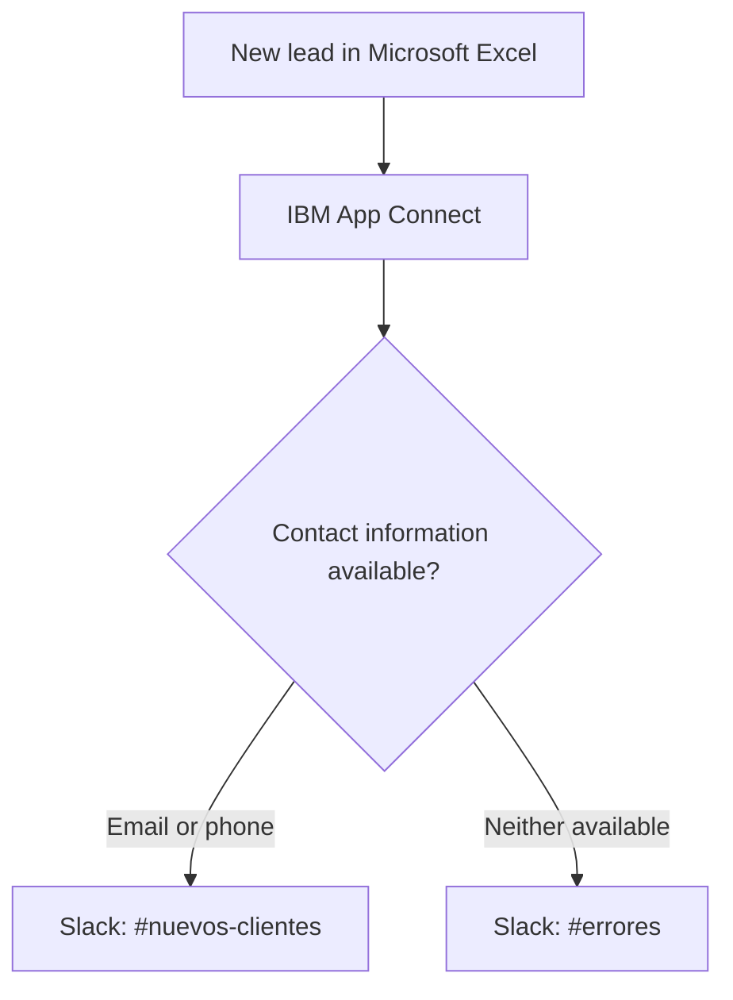

# IBM App Connect — Business Process Automation

Academic project developed at the **University of A Coruña (UDC)** to evaluate IBM App Connect as an Integration Platform as a Service (iPaaS) for business process automation.

## Overview

This project explores how IBM App Connect can integrate SaaS applications and automate business workflows through visual, event-driven flows.

The practical case study automates lead management by connecting **Microsoft Excel and Slack**, replacing manual spreadsheet monitoring with automatic notifications and data validation.

## Key Features

- **Application integration:** Connected Microsoft Excel and Slack using IBM App Connect's built-in connectors.
- **Event-driven automation:** Triggered workflows when new rows were added to an Excel table.
- **Data mapping:** Transferred lead information between applications using dynamic fields.
- **Conditional validation:** Checked whether each lead contained at least an email address or a phone number.
- **Error handling:** Routed leads with missing contact information to a dedicated Slack channel for review.
- **Monitoring and traceability:** Used Slack notifications and execution monitoring to track workflow behavior.

## Architecture

## Technologies & Tools

- **IBM App Connect** — Integration flows and workflow automation
- **Microsoft Excel** — Lead data source and event trigger
- **Slack** — Notifications and error reporting
- **OAuth 2.0** — Application connection authorization
- **Event-driven integration** — Workflow orchestration and conditional routing

## Results

- Automated lead notifications, replacing periodic manual spreadsheet checks.
- Observed notification delivery in approximately **30 seconds** during testing.
- Implemented conditional routing to distinguish actionable leads from incomplete records.
- Improved data quality and operational traceability by notifying the appropriate team based on validation results.

## Project Context

This work was completed as part of the *Application Integration* course at the Faculty of Computer Science, University of A Coruña, during the 2025–2026 academic year.

**Authors:** Brais Fernández Reyes, Pablo Ferreiro Gil, Diego Saavedra Saavedra

---

*This project evaluates a low-code integration platform through a practical business automation scenario.*
